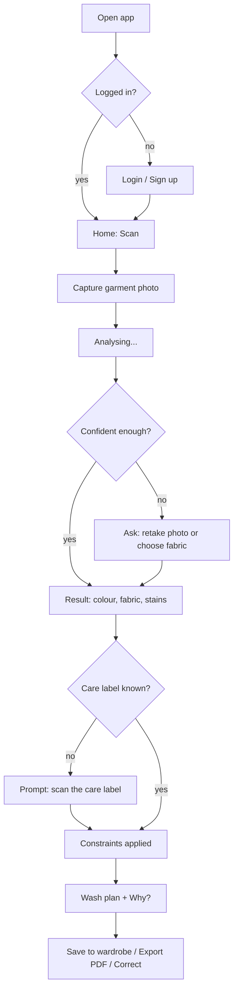

# 03. Product Requirements Document (PRD): LaundryMann 2.0

## 1. Product summary
A mobile-first web app (PWA). Point the camera at a garment or a laundry pile → get a plain-language wash plan with reasons, warnings, and safe load groups.

## 2. Personas

| Persona | Profile | Goals | Frustrations |
|---|---|---|---|
| **Asha, 28, hostel/flat resident** | Washes in a semi-automatic or top-loader, mixes loads to save time | Avoid colour bleed, keep favourite kurta/shirts | Doesn't know fabric names; skips labels |
| **Rahul, 40, parent** | Big weekly loads, kids' stains (food, ink, mud) | Get stains out without ruining school uniforms | Guesses temperatures |
| **Meera, 55, silk/wool owner** | Owns delicate items, cautious | Certainty that a delicate item is safe | Fear of ruining sarees/sweaters |
| **Dev (you)** | Maintainer | Clean, testable code | Legacy tangle |

## 3. Goals and non-goals
**Goals:** correct, safe, explainable advice; abstain when unsure; one polished mobile-first UI; private by design.
**Non-goals:** industrial sorting robotics; real sensors; social features; e-commerce; guaranteeing stain removal.

## 4. Feature list (MoSCoW)

| ID | Feature | MoSCoW | Release |
|---|---|---|---|
| F1 | Sign up / login / logout / delete account | Must | R1 |
| F2 | Scan single garment (camera/upload) | Must | R1 |
| F3 | Colour family + bleed-risk class (from segmented garment pixels) | Must | R1 |
| F4 | Fabric estimate with confidence words and "Not sure" state | Must | R2 |
| F5 | Stain detection (boxes) + user picks stain type | Must | R2 |
| F6 | Care-label scan (OCR + symbols) → hard constraints | Must | R2 |
| F7 | Wash plan with "Why?" evidence | Must | R2 |
| F8 | Basket scan and safe load grouping | Should | R3 |
| F9 | Wardrobe (saved items, history) | Should | R3 |
| F10 | Corrections/feedback with opt-in for improvement | Should | R3 |
| F11 | PDF wash guide export | Could | R3 |
| F12 | Stain-type *suggestion* model (needs own data) | Could | R4 |
| F13 | Insights (real counts only) | Could | R4 |
| F14 | Sensors (E-nose/UV) | Won't | n/a |
| F15 | Robotic sorting | Won't | n/a |

## 5. Key user flows

## 6. Requirements summary (detail in SRS/FRD)
Analysis in ≤ 2 s p95 on CPU (proposed); every result shows confidence in words; every warning is explicit; accessibility AA; works offline for viewing saved wardrobe (service worker cache).

## 7. Product metrics

| Metric | Definition | Target |
|---|---|---|
| Task success | User obtains a wash plan for a garment | ≥ 90% |
| Time to plan | Open app → plan displayed | ≤ 60 s median |
| Correction rate | % of results the user corrected | Tracked; falling trend per release |
| Abstention rate | % analyses ending in "Not sure" | 10-25% (too low = overconfident; too high = useless) |
| Safety incidents | Reports of harmful advice | 0 |

## 8. Release criteria
R1: F1-F3 working, 0 S1/S2 defects. R2: models meet §7 of PD on frozen + field sets; care constraints property-tested. R3: basket + wardrobe; security suite green. R4 (optional): stain-type suggestion when own dataset has ≥ 150 labelled examples per type.

## 9. Assumptions and open questions
* Users will photograph labels if prompted well (test in usability sessions).
* Which languages? (Start English; design strings for i18n; Hindi/Kannada later.)
* Indian wash context: many users hand-wash or use top-loaders, so wash plan offers "hand wash" and "top-loader" variants, not only machine cycles.
* Open: default temperature vocabulary (°C only vs also "cold/warm/hot").
