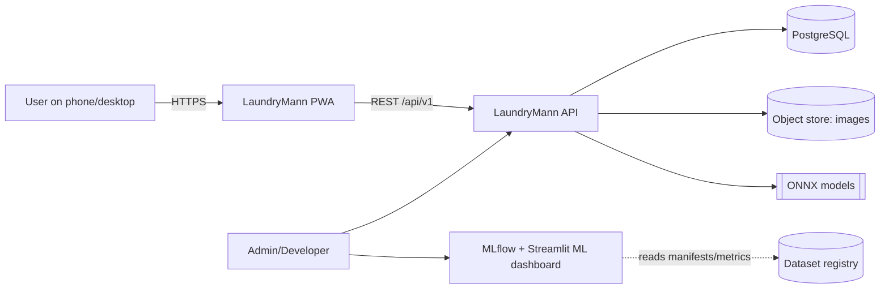
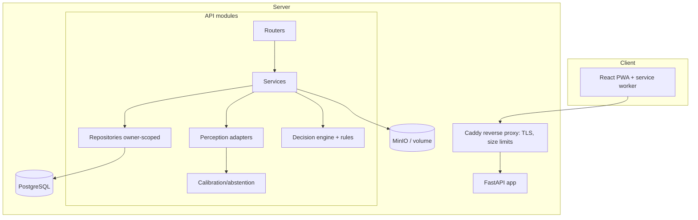
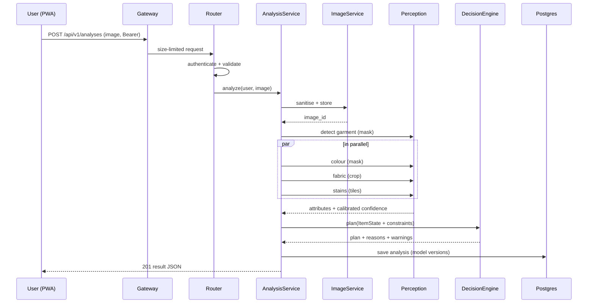

# 07. Software Architecture Document (SAD): LaundryMann 2.0

## 1. Architectural drivers

| Driver | Consequence |
|---|---|
| Safety (no harmful advice) | Perception separated from decision; hard constraints in a dedicated, heavily tested layer |
| Trustworthy uncertainty | Calibration + abstention are first-class components, not afterthoughts |
| Solo maintainability | Modular monolith, not microservices |
| Privacy | Local inference, private storage, retention jobs |
| Reproducibility | Everything containerised, models and data hashed |

## 2. Context view (C4 level 1)

## 3. Container view (C4 level 2)

## 4. Component responsibilities

| Component | Responsibility | Depends on | Notes |
|---|---|---|---|
| `routers/*` | HTTP, auth dependency, schema validation | services | No business logic |
| `AuthService` | Register/login/refresh/revoke | UserRepo, TokenRepo | Argon2id, JWT |
| `ImageService` | Validate, sanitise, store, sign URLs | ObjectStore | Security S4 |
| `AnalysisService` | Orchestrate perception → state → plan | perception, decision | Idempotent per image hash |
| `GarmentDetector` | Segment garments | ONNX | Interface `Detector` |
| `ColourAnalyzer` | LAB palette, family | numpy/OpenCV | Pure functions |
| `FabricClassifier` | Fabric probs + conformal set | ONNX, Calibrator | Returns `unknown` |
| `StainDetector` | Tiled stain detection | ONNX | |
| `CareLabelReader` | OCR + symbols → constraints | OCR, ONNX | Strictness merge |
| `Calibrator` | Temperature + conformal | fitted params file | Versioned with model |
| `DecisionEngine` | Constraints + rules → plan | rules YAML | Pure, deterministic |
| `LoadPlanner` | Conflict graph → loads | DecisionEngine | Pure |
| `WardrobeService` | CRUD | Repos | |
| `PrivacyService` | Export, delete, retention | Repos, ObjectStore | Scheduled job |
| `ModelRegistry` | Load, verify hash, expose versions | filesystem | Readiness gate |

## 5. Key runtime sequence: analyse a garment

## 6. Deployment view

Single host (VPS) running compose: `caddy`, `api`, `db`, `minio`. TLS at Caddy; internal network only for db/minio; api container non-root with read-only FS and a tmpfs for scratch. Scale path: run 2+ API replicas behind Caddy; move inference to a separate worker only if CPU contention appears (measured).

## 7. Quality attribute tactics

| Attribute | Tactic |
|---|---|
| Safety | Hard-constraint layer, never-do rules, property tests, mutation testing on engine |
| Security | Threat model (doc 14), owner-scoped repositories, upload sanitiser, ONNX only |
| Performance | ONNX Runtime, int8/fp16, parallel stages, image downscale, tiling only for stain stage |
| Reliability | Readiness gate, timeouts, circuit-breaker on OCR, graceful "cannot analyse" |
| Maintainability | Interfaces around models, pure decision code, single rules file, ADRs |
| Testability | Dependency injection for models (fakes in tests), golden scenarios |
| Observability | Structured logs, metrics, model-version headers |

## 8. Data architecture
Relational metadata (doc 09); images in object store; rule sets and models on filesystem with hashes; dataset manifests in git (no images). Retention job deletes expired images and their rows.

## 9. Technical-debt elimination map (v1 → v2)

| v1 structure | v2 replacement |
|---|---|
| `app.py` (Tkinter), `src/app.py`, `streamlit_app.py`, `frontend/` | `apps/web` React PWA (+ dev-only Streamlit) |
| `models.py` w/ 3 models loaded in a background thread | `ModelRegistry` + readiness gate |
| `decision_engine.py` if/else + bins A-G | `DecisionEngine` + YAML rules + hard/soft separation |
| 3 copies of recipe table | one `rules/wash_plans.yaml` |
| `auth.py` (SHA-256) + cookie username | `AuthService` (Argon2id, JWT, rotating refresh) |
| Weights committed to git | Release assets / HF Hub / DVC; hashes in registry |
| `Dockerfile` with Jupyter | Multi-stage non-root app image |

## 10. Risks to the architecture
Model size vs CPU budget (mitigate: quantise, smaller backbones); OCR variability (mitigate: user-assisted crop); AGPL (ADR-04). See Risk Register.
