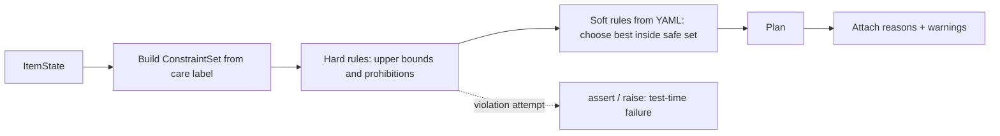

# 08. Technical Design Document (TDD): LaundryMann 2.0
*Includes the Test-Driven Development plan (both meanings of "TDD").*

## 1. Module design

### 1.1 Domain types (Pydantic v2)

```python
class ColourFamily(str, Enum): WHITE="white"; LIGHT="light"; PASTEL="pastel"; BRIGHT="bright"; DARK="dark"; MULTI="multi"
class BleedRisk(str, Enum): RECEIVER="receiver"; LOW="low"; HIGH="high"
class Fabric(str, Enum): COTTON="cotton"; LINEN="linen"; SILK="silk"; WOOL="wool"; SYNTH="synthetic"; DENIM="denim"; OTHER="other"; UNKNOWN="unknown"

class Attribute(BaseModel, Generic[T]):
    value: T
    confidence: float            # calibrated, 0..1
    source: Literal["model","ocr","symbol","user","rule"]
    alternatives: list[tuple[T, float]] = []

class CareConstraints(BaseModel):
    max_wash_temp_c: int | None = None
    agitation: Literal["normal","gentle","hand_only","do_not_wash"] | None = None
    bleach: Literal["any","non_chlorine","none"] | None = None
    tumble: Literal["normal","low","none"] | None = None
    iron_max_c: Literal[110,150,200] | None = None
    dry_clean_only: bool = False

class ItemState(BaseModel):
    category: Attribute[str]
    colour_family: Attribute[ColourFamily]
    bleed_risk: BleedRisk
    fabric: Attribute[Fabric]
    stains: list[Stain]
    constraints: CareConstraints
```

### 1.2 Colour analysis algorithm (deterministic)

```
def analyse_colour(image_rgb, mask):
    px = image_rgb[erode(mask, 5)]                 # garment pixels only
    lab = rgb2lab(px)
    lab = lab[(lab.L > 10) & (lab.L < 95)]         # drop deep shadow and specular highlights
    centers, weights = kmeans(lab, k=3, n_init=5)  # fixed seed
    palette = merge_close(centers, weights, dE<12) # CIEDE2000
    family = family_rules(palette)                 # table in FRD M4
    confidence = separability(palette, family)     # margin to nearest rule boundary
    return palette, family, bleed_risk(family, palette), confidence
```
Unit tests: pure white, pure black, red, denim blue, two-tone stripe, shadowed white, saturated pastel boundary (ΔE tolerances).

### 1.3 Calibration and abstention

```
def predict_fabric(logits, T, q_hat):
    p = softmax(logits / T)
    pred_set = {c for c in classes if p[c] >= 1 - q_hat}   # split-conformal (LAC score)
    if len(pred_set) == 0 or len(pred_set) > 2 or p.max() < ABSTAIN_MIN_PROB:
        return Attribute(value=UNKNOWN, confidence=float(p.max()), alternatives=top3(p))
    return Attribute(value=argmax(p), confidence=float(p.max()), alternatives=top3(p))
```
`T` from validation NLL minimisation; `q_hat` = ⌈(n+1)(1−α)⌉/n quantile of calibration scores `1 − p[true]`.

### 1.4 Decision engine



Rule file format (`rules/wash_plans.yaml`):

```yaml
version: 1.0.0
hard:
  - id: H-BLEACH-SILK
    when: {fabric_in: [silk, wool, unknown]}
    forbid: {bleach: [any, non_chlorine_unless_label]}
    reason: "Bleach can damage protein fibres (silk, wool) and unknown fabrics."
  - id: H-PROTEIN-COLD
    when: {stain_type_in: [blood, protein]}
    cap: {temp_c: 30}
    reason: "Heat sets protein stains."
  - id: H-DRYCLEAN
    when: {dry_clean_only: true}
    forbid: {home_wash: true}
soft:
  - id: S-DARK-COLD
    when: {colour_family_in: [dark, bright]}
    prefer: {temp_c: 30, detergent: colour_safe, wash_separately: true}
    priority: 50
    reason: "Dark and bright items can bleed."
```
Conflict resolution: hard > label > user override (only *stricter*) > soft by priority. Engine returns a **trace** of applied rules.

### 1.5 Load planner (conflict graph)

```
def plan_loads(items, capacity):
    G = graph(items)
    for a, b in pairs(items):
        if incompatible(a, b): G.add_edge(a, b)     # see FRD M9
    colours = dsatur_colouring(G)                   # deterministic tie-break by item id
    loads = group_by(colours)
    loads = merge_if_compatible(loads, capacity)    # intersect param ranges
    return [Load(items, shared_params(items), explain(items)) for items in loads]
```
`incompatible` = bleed high×receiver, hot-only×delicate, agitation mismatch, dry-clean-only, heavy-soil×delicate. Complexity O(n²) (n ≤ 20).

## 2. API design principles
Resource-oriented, versioned (`/api/v1`), IDs UUID, cursor pagination, idempotency key on `POST /analyses`, `ETag` on wardrobe items, problem+json errors, separate `*In` / `*Out` schemas. Core endpoints (full spec in `openapi.yaml`):

| Method | Path | Purpose |
|---|---|---|
| POST | /auth/register, /auth/login, /auth/refresh, /auth/logout | Session |
| POST | /images | Upload + sanitise (kind=garment/basket/label) |
| POST | /analyses | Analyse garment/basket (image_id(s), optional label_image_id) |
| GET | /analyses/{id} | Result |
| PATCH | /analyses/{id}/corrections | User correction |
| POST | /loads/plan | Group analyses into loads |
| GET/POST/PATCH/DELETE | /wardrobe/items | Wardrobe |
| GET | /analyses/{id}/guide.pdf | PDF |
| GET | /me/export; DELETE /me | Privacy |
| GET | /health/live, /health/ready | Ops |
| GET | /admin/models; POST /admin/models/{id}/activate | Admin |

## 3. Error handling design
Domain exceptions (`NoGarmentFound`, `ImageTooBlurry`, `ModelUnavailable`, `LowConfidence`) map to problem+json. Perception failures never fabricate defaults. Timeouts: OCR 3 s, whole analysis 10 s.

## 4. Concurrency and resource control
`asyncio.Semaphore(INFERENCE_CONCURRENCY)`; CPU-bound calls in `run_in_executor` with a process pool (ONNX Runtime releases the GIL but pre/post-processing does not); queue length cap → `503 + Retry-After`. Models loaded once at startup **before** the readiness probe flips (v1 served requests while models were still loading).

## 5. Logging design
Fields: `ts, level, request_id, user_hash, route, status, latency_ms, model_versions, abstained(bool)`.

## 6. Test-Driven Development plan

**Cycle:** red → green → refactor, per requirement. Order of construction (each step begins with failing tests):

| Step | First failing tests | Then implement |
|---|---|---|
| 1 | `test_colour_family_boundaries`, `test_white_shirt_shadow` | `ColourAnalyzer` |
| 2 | `test_constraint_merge_strictest_wins` | `CareConstraints.merge` |
| 3 | `test_never_bleach_silk`, `test_protein_stain_cap`, property test over random ItemStates | `DecisionEngine` hard rules |
| 4 | Golden scenarios (50 YAML cases) | soft rules + reasons |
| 5 | `test_no_conflicting_pair_in_same_load` (hypothesis) | `LoadPlanner` |
| 6 | `test_conformal_coverage_synthetic`, `test_abstain_on_ambiguous_logits` | `Calibrator` |
| 7 | Upload abuse fixtures | `ImageService` |
| 8 | IDOR suite, JWT tamper suite | Auth + repositories |
| 9 | Contract tests (schemathesis) | Routers |
| 10 | Playwright happy-path + low-confidence path | PWA |

**Hypothesis strategy example:** generate arbitrary `ItemState` (any fabric/colour/stains/constraints) → plan → assert `plan.temp_c <= constraints.max_wash_temp_c`, `plan.bleach` not in forbidden set, `plan.reasons` non-empty.

**Mutation testing:** `mutmut` on `rules/` engine and `LoadPlanner`; survivors ≥ 10% block release.

## 7. Design for extension (no implementation now)
`Analysis` rows are immutable and time-stamped; a future `treatments` + `outcomes` table can reference `analysis_id` without changing existing tables.
