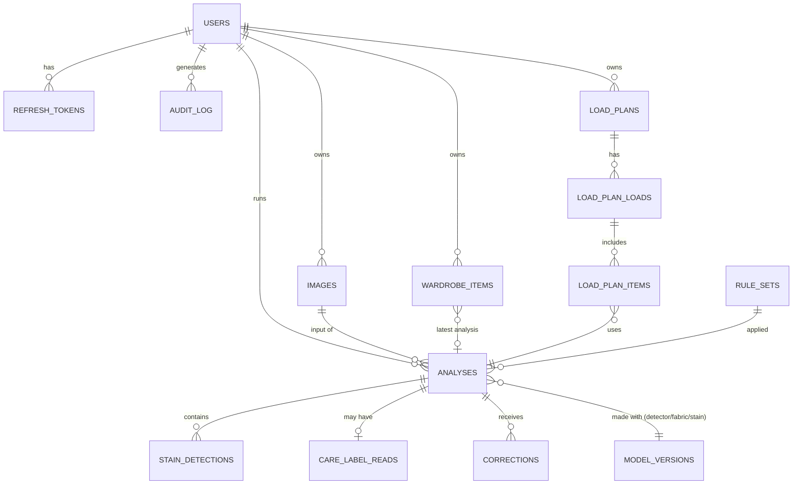

# 09. Database Schema and ER: LaundryMann 2.0

Engine: PostgreSQL 16. Machine-readable DDL: **`schema.sql`**. Migrations via Alembic.

## 1. ER diagram

## 2. Data dictionary (summary)

| Table | Purpose | Key columns / notes |
|---|---|---|
| `users` | Accounts | `id uuid pk`, `email citext unique`, `password_hash`, `display_name`, `role`, `share_for_training bool default false`, `created_at`, `deleted_at` |
| `refresh_tokens` | Rotating refresh tokens | `token_hash` (SHA-256), `family_id`, `expires_at`, `revoked_at`, `replaced_by` |
| `images` | Sanitised uploads | `owner_id`, `kind`, `storage_key`, `sha256`, `width`, `height`, `blur_score`, `expires_at` |
| `model_versions` | Registry | `name`, `version`, `sha256`, `metrics jsonb`, `is_active`, `licence_note` |
| `rule_sets` | Versioned rules | `version`, `sha256`, `content_path` |
| `analyses` | One analysis result | `owner_id`, `image_id`, `garment_category`, `colour_family`, `bleed_risk`, `palette jsonb`, `fabric_value`, `fabric_conf`, `fabric_source`, `plan jsonb`, `reasons jsonb`, `warnings jsonb`, `abstained bool`, `detector_mv`, `fabric_mv`, `stain_mv`, `rule_set_id`, `created_at` |
| `stain_detections` | Boxes per analysis | `analysis_id`, `bbox`, `score`, `area_pct`, `stain_type` (nullable, user-set), `type_source` |
| `care_label_reads` | Structured label | `analysis_id`, `raw_text`, `constraints jsonb`, `symbols jsonb`, `source_conf jsonb` |
| `corrections` | User fixes | `analysis_id`, `attribute`, `old_value`, `new_value`, `status` (quarantined/approved/rejected), `share_ok` |
| `wardrobe_items` | Saved garments | `owner_id`, `name`, `latest_analysis_id`, `notes`, `archived_at` |
| `load_plans`, `load_plan_loads`, `load_plan_items` | Grouping results | Ordered loads; explanation text |
| `audit_log` | Security/audit events | `user_id`, `event`, `ip_hash`, `meta jsonb`, `ts` |

## 3. Integrity rules
* All FKs `ON DELETE CASCADE` from `users` (supports full erasure) except `model_versions`/`rule_sets` (`RESTRICT`).
* Checks: `fabric_conf between 0 and 1`; enum-like checks via `CHECK ... IN (...)`; `area_pct between 0 and 100`.
* Unique: `(owner_id, sha256)` on `images` to dedupe uploads; only one active model per `name`.
* Row ownership enforced in the repository layer *and* optionally by PostgreSQL Row-Level Security policies (defence in depth).

## 4. Indexing

| Index | Reason |
|---|---|
| `analyses (owner_id, created_at desc)` | History list |
| `images (owner_id, expires_at)` | Retention job |
| `corrections (status, created_at)` | Review queue |
| `refresh_tokens (family_id)`, `(token_hash)` | Rotation/reuse detection |
| `wardrobe_items (owner_id) where archived_at is null` | Active list |

## 5. Retention and deletion
Nightly job: delete `images` past `expires_at` (row + object); analyses keep derived data but null `image_id`. `DELETE /me` hard-deletes all owned rows and objects within 30 days (immediately disabled).

## 6. v1 → v2 data notes
v1 used SQLite `wardrobe.db` (global, not per user) and `laundry_users.db` (unsalted SHA-256). Do **not** migrate password hashes; require reset. Wardrobe rows can be imported into a chosen owner account.

## 7. Migration policy
One Alembic revision per change; every `upgrade` has a tested `downgrade`; CI applies all migrations on an empty DB and diffs against models (`alembic check`).
