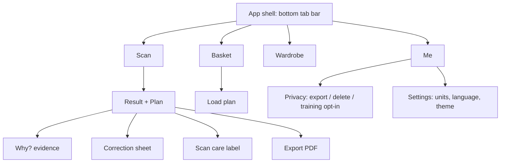

# 10. UI/UX Design and Wireframes: LaundryMann 2.0

## 1. UX goals and why v1's UI is replaced
v1 shipped four UIs (Tkinter, two Streamlit apps, vanilla JS). The Streamlit version depended on heavy CSS overrides and stored login in a forgeable cookie; the vanilla page had hard-coded `http://localhost:8000` and rebuilt the results with `innerHTML`. v2 has **one** mobile-first PWA that treats the camera as the primary input and uncertainty as a visible part of the design.

## 2. Information architecture



## 3. Task flows tested in usability sessions
T1 "Get a wash plan for this shirt" (≤ 90 s). T2 "Fix the fabric because it's wrong". T3 "Sort this pile into loads". T4 "Delete my account and data".

## 4. Wireframes (mobile, 360×780)

### W1 Login / Sign up
```
+--------------------------------+
|  LaundryMann                   |
|                                |
|  Email      [________________] |
|  Password   [________________] |
|             (show)             |
|  [        Log in            ]  |
|  New here?  Create account     |
|                                |
|  Privacy: photos stay on your  |
|  server. Read how →            |
+--------------------------------+
```

### W2 Scan (home)
```
+--------------------------------+
| Scan a garment          (?)    |
|  +--------------------------+  |
|  |  [ live camera ]         |  |
|  |     +-----------+        |  |
|  |     |  frame    |        |  |
|  |     |  garment  |        |  |
|  |     +-----------+        |  |
|  |  Tip: lay flat, good     |  |
|  |  light, fill the frame   |  |
|  +--------------------------+  |
|  [ Upload photo ]   ( ◉ )      |
|  Mode:  (•) Garment  ( ) Pile  |
|--------------------------------|
| Scan | Basket | Wardrobe | Me  |
+--------------------------------+
```
States: permission denied → "Use Upload instead"; too dark/blurry → inline hint before sending.

### W3 Analysing
```
+--------------------------------+
|  Analysing your garment…       |
|  ▓▓▓▓▓▓▓░░░░  Looking for      |
|  stains and checking colour    |
|  [ Cancel ]                    |
+--------------------------------+
```

### W4 Result + plan
```
+--------------------------------+
| ← Result                 ⋮     |
| [ photo with stain outlines ]  |
|                                |
| Colour   ● Dark blue   HIGH    |
| Fabric   Cotton (likely) MED ▸ |
| Stains   2 found  ▸ (set type) |
|--------------------------------|
| ⚠ Wash separately: may bleed   |
|--------------------------------|
| WASH PLAN                      |
|  Cold 30 °C · Gentle · Colour  |
|  detergent · No bleach         |
|  Pre-treat: dab stain #1 with  |
|  detergent, wait 10 min        |
|  Dry: hang · Iron: medium      |
|  [ Why this plan? ▾ ]          |
|                                |
| [ Save ] [ Fix something ] [PDF]|
+--------------------------------+
```

### W5 "Why this plan?" (expanded evidence)
```
| Why this plan?                 |
|  • Care label: max 30 °C  (label)|
|  • Dark colour → bleed risk (rule S-DARK-COLD)|
|  • Fabric cotton, 62% sure     |
|  • No protein stain detected   |
|  Rules version 1.0.0 · Models  |
|  fabric v3, stain v2           |
```

### W6 Not-sure state
```
+--------------------------------+
| I'm not sure about the fabric  |
| It could be Cotton or Synthetic|
|  [ Scan the care label ]       |
|  [ Choose fabric ▾ ]           |
|  [ Retake photo ]              |
+--------------------------------+
```

### W7 Correction bottom sheet
```
| Fix a detail                   |
| What's wrong?  (•) Fabric      |
|                ( ) Colour      |
|                ( ) Stain type  |
| Correct value  [ Silk ▾ ]      |
| [ ] Allow this photo to help   |
|     improve the app (optional) |
| [ Save correction ]            |
```

### W8 Basket → load plan
```
| Your pile: 9 items             |
|  Load 1  (5 items) 30 °C gentle|
|   [thumb][thumb][thumb]…       |
|   Why together: all dark, cotton|
|  Load 2  (3 items) 40 °C normal|
|   Why apart: white shirt vs red|
|  Hand wash (1): silk scarf     |
|  Dry-clean only (0)            |
```

### W9 Wardrobe
```
| Wardrobe            [ + Add ]  |
| [search…]                      |
| [card] Blue kurta   Cotton ✓   |
| [card] Silk scarf   Hand wash  |
| (empty: "Scan your first item")|
```

### W10 Me / Privacy
```
| Me                             |
| Email …                        |
| Photo retention  [90 days ▾]   |
| [ ] Allow my corrections to    |
|     improve models (off)       |
| [ Export my data ]             |
| [ Delete account and data ]    |
```

## 5. Desktop layout
Two-column: left = image with overlay toggles (stains / mask), right = plan and evidence. Keyboard shortcuts: `U` upload, `S` save, `?` help.

## 6. Interaction states matrix

| Screen | Empty | Loading | Error | Low-confidence |
|---|---|---|---|---|
| Scan | Tips | Camera init spinner | Permission / no camera | n/a |
| Result | n/a | Skeleton + progress | "Couldn't analyse. Try again" + request id | W6 |
| Wardrobe | First-use prompt | Skeleton cards | Retry banner | n/a |

## 7. Microcopy rules (examples)
* Confidence chips: HIGH "Sure", MEDIUM "Likely", LOW "Guess", UNSURE "Not sure".
* Warnings start with an icon and a verb: "Wash separately", "Do not bleach".
* Disclaimer (persistent, small): "Guidance only. Always follow your garment's care label."

## Design system foundations (shared)

### Principles
1. **Honest uncertainty**: always show confidence in words ("Likely cotton", "Not sure") plus an easy way to correct. Never show a bare percentage as truth.
2. **Safety first, then convenience**: warnings are visually distinct and never hidden behind a tap.
3. **One primary action per screen**: scan first, everything else second.
4. **Camera-first, thumb-friendly**: primary controls in the bottom 40% of the screen on mobile.
5. **Explain why**: every recommendation has a "Why?" that lists the evidence and rule used.

### Design tokens (CSS custom properties)

```css
:root {
  /* Color: light theme */
  --bg: #F7F8FA;         --surface: #FFFFFF;     --surface-2: #EEF1F5;
  --text: #14171C;       --text-muted: #5A6472;  --border: #D9DEE5;
  --primary: #2F6FED;    --primary-contrast: #FFFFFF;
  --success: #1E8E5A;    --warning: #B26B00;     --danger: #C62828;   --info: #0B6E99;
  --focus: #1B4FD1;
  /* Spacing (4px base) */
  --s-1: 4px; --s-2: 8px; --s-3: 12px; --s-4: 16px; --s-5: 24px; --s-6: 32px; --s-7: 48px;
  /* Radius / elevation */
  --r-sm: 6px; --r-md: 12px; --r-lg: 20px;
  --shadow-1: 0 1px 2px rgba(20,23,28,.08); --shadow-2: 0 6px 20px rgba(20,23,28,.12);
  /* Type */
  --font: "Inter", system-ui, -apple-system, "Segoe UI", Roboto, sans-serif;
  --fs-xs: 12px; --fs-sm: 14px; --fs-md: 16px; --fs-lg: 20px; --fs-xl: 28px;
  --lh: 1.5;
  /* Motion */
  --ease: cubic-bezier(.16,1,.3,1); --t-fast: 120ms; --t-med: 220ms;
}
@media (prefers-color-scheme: dark) {
  :root { --bg:#0E1116; --surface:#161B22; --surface-2:#1E252E; --text:#E8ECF1;
          --text-muted:#9AA6B5; --border:#2A323D; --primary:#6C9BFF; --focus:#8FB3FF; }
}
@media (prefers-reduced-motion: reduce) { * { animation: none !important; transition: none !important; } }
```

Why these choices: the old UI used a heavy "glassmorphism/obsidian" theme injected with aggressive CSS overrides on Streamlit; it was fragile and low-contrast. A restrained token system is easier to keep accessible (WCAG 2.2 AA contrast ≥ 4.5:1 for text) and to theme.

### Core components

| Component | Purpose | States to design |
|---|---|---|
| `CameraCapture` | Live camera + framing guide + shutter | permission-denied, low-light hint, blur warning |
| `ConfidenceChip` | Words + icon for High / Medium / Low / Unsure | all four |
| `EvidenceCard` | "Why?" panel listing detections and rules | collapsed / expanded |
| `WarningBanner` | Safety/care warnings | info / warning / danger |
| `CorrectionSheet` | Bottom sheet to fix a wrong label | idle / saving / saved |
| `ItemCard` | Thumbnail + name + status | default / selected / loading skeleton |
| `EmptyState` | Friendly first-use guidance | per screen |
| `Toast` | Non-blocking feedback (aria-live polite) | success / error |

### Accessibility checklist (WCAG 2.2 AA)
Keyboard operable; visible focus ring (`--focus`, 3 px); labels for all inputs; alt text for result images ("Photo of your shirt with 2 stain regions outlined"); do not rely on color alone (icons + text); touch targets ≥ 44×44 px; `aria-live` for analysis results; supports 200% zoom; respects reduced motion; camera alternative (file upload) always available.

### Content style
Plain language, no jargon in primary text ("Wash cold, gentle" not "BIN_D"), numbers with units (30 °C), and never claim certainty the model doesn't have.

## LaundryMann-specific visual language
* Colour swatches are shown next to colour names so colour is never conveyed by text alone.
* Stain overlays use dashed outlines with numbered tags; tapping a tag opens the stain-type picker.
* Warning hierarchy: `danger` = "Do not…" (never collapsible), `warning` = "Consider…", `info` = tips.

## Figma/handoff notes
Frames at 360, 768, 1280 px; components named as in the table above; export tokens to `tokens.json` (Style Dictionary) so CSS and Figma stay in sync.
