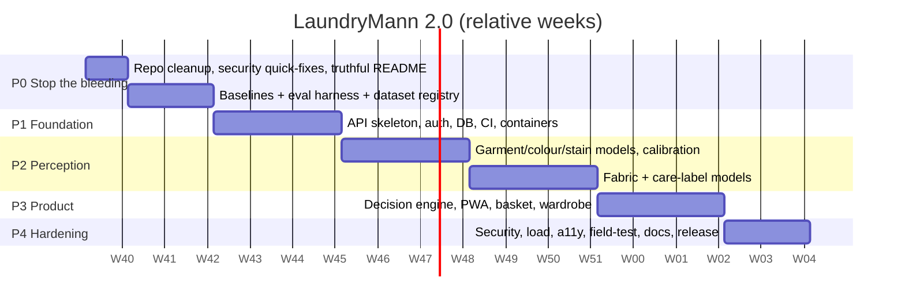

# 12. Roadmap: LaundryMann 2.0

Assumptions: 1 developer, ~12 h/week, 16 weeks; free GPU tiers for training. Calendar starts when you decide (week numbers are relative). Estimates include a 25% buffer.

## 1. Phase overview

## 2. Phases, deliverables, exit criteria

| Phase | Weeks | Deliverables | Exit criteria (must all hold) |
|---|---|---|---|
| **P0 Stop the bleeding** | 1-3 | Remove forged-cookie auth; delete weights from git history (or move to releases); fix `.gitignore`; delete dead UIs; honest README; reproduce v1 numbers; dataset registry with licence check; eval harness; **field set v0 (100 photos)**; baseline latency measurement | v1 attack (forged cookie) fails; README claims all reproducible or removed; baseline report committed; SLOs frozen |
| **P1 Foundation** | 4-6 | FastAPI skeleton, Argon2id + JWT + rotating refresh, Postgres + Alembic, owner-scoped repos, image sanitiser, OpenAPI, Docker compose, CI (lint, type, tests, scans), IDOR/JWT/upload suites | CI green; clean-clone run ≤ 15 min; security suites pass |
| **P2a Perception 1** | 7-9 | Garment seg. (DeepFashion2 fine-tune), LAB colour analyser, stain detector (FabricSpotDefect+field), ONNX export, calibration code | Targets met on frozen test; ONNX parity; latency within budget |
| **P2b Perception 2** | 10-12 | Fabric classifier (TextileNet subset+FabricClassv2), conformal abstention, care-label OCR + symbol models (synthetic + real) | Fabric macro-F1 ≥ 0.70, ECE ≤ 0.05; symbols ≥ 75% real |
| **P3 Product** | 13-15 | YAML rules + engine, load planner, React PWA (all wireframes), wardrobe, corrections, PDF | Property tests 0 violations; E2E happy + low-conf paths pass; usability test with 5 users |
| **P4 Hardening & release** | 16 | ZAP scan, load test, axe audit, field test v1 (300 photos), model cards, SBOM, docs polish, v1.0 tag | Release checklist complete (QAP Q8) |

## 3. Milestones

| ID | Milestone | Week |
|---|---|---|
| M0 | v1 neutralised (no known critical vulns, honest README) | 3 |
| M1 | Secure API + CI | 6 |
| M2 | Colour + stain pipeline end-to-end | 9 |
| M3 | Fabric + care label with abstention | 12 |
| M4 | Feature-complete PWA | 15 |
| M5 | v1.0 release | 16 |

## 4. Dependencies and critical path
Field set collection (P0) blocks meaningful evaluation; dataset access approvals (DeepFashion2 form) can take days → request in week 1; GPU quota blocks P2 → schedule training slots; decision-rule review by a knowledgeable person before P3 exit.

## 5. Capacity and contingency
If time is short, cut in this order: PDF export → insights → load planner merge step → care-symbol recognition (keep OCR-only) → hand-wash variants. **Never cut:** security, calibration/abstention, hard-constraint tests, honest README.

## 6. Post-v1.0 backlog (parked)
Stain-type suggestion model (needs ≥ 150 labelled examples per type), Hindi/Kannada UI, native wrapper, optional real sensor adapter, and the separate flagship idea to be discussed later.

## 7. Weekly cadence
Mon plan (pick tickets tied to requirement IDs) → Wed mid-week risk review → Fri demo + update RTM and risk log; monthly dependency/licence review.
