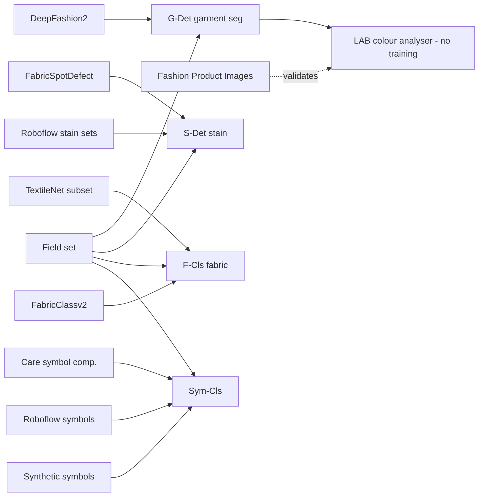

# 17. Dataset Plan: LaundryMann 2.0
*Datasets checked against their source pages on 19 Sep 2026. Sizes are as published by the source. "Licence" must be verified by you (see common standard C2).*

## 1. Selection logic
LaundryMann needs five kinds of data: (1) garments in scenes (detection/segmentation), (2) colour ground truth (validation), (3) stains, (4) fabric/fibre appearance, (5) care labels/symbols. No single dataset covers these, and **no public dataset pairs stain *type* with fabric at scale**, so stain type is user-labelled in v2 and collected for later. Data that does not match the task was rejected (see §5).

## 2. Chosen datasets: exact links, role, and reasoning

| ID | Dataset | Exact link | Size (published) | Role in project | Why chosen | Known caveats |
|---|---|---|---|---|---|---|
| D1 | **FabricSpotDefect** (Data in Brief 2024) | https://data.mendeley.com/datasets/6574nhzm8x/1 (DOI 10.17632/6574nhzm8x.1) | 1,014 raw images, ≈3.3k spot annotations (2,300 augmented images / 7.6k boxes also provided); photographed with three Samsung phones at home in natural light | **Stain detector (S-Det)** primary training/eval source | Real home clothes, phone camera, cotton/linen/silk/denim/patterned, stains incl. oil, ink, coffee, blood, rust, sweat; splits provided (train/val/test) | Single class "Spot" (no stain type); some "spots" are dye stains or defects; **use original images for eval, not augmented copies** |
| D2 | Fabric Stain Detection (Roboflow) | https://universe.roboflow.com/college-wtlzk/fabric-stain-detection | See page (not verified) | Supplementary stain boxes | More diversity | Small, unknown label quality; verify licence |
| D3 | Stain Clothing (Roboflow) | https://universe.roboflow.com/walailak-gelwu/stain-clothing | 25 images | Sanity checks only | Clothing-specific | Too small to train on |
| D4 | **DeepFashion2** | https://github.com/switchablenorms/DeepFashion2 (data via the form linked in the README; the form provides the unzip password) | 491K images, 13 clothing categories, 801K items with boxes, masks, landmarks; splits 391K/34K/67K | **Garment detector/segmenter (G-Det)** | Large, includes consumer (user-taken) photos, instance masks needed for colour analysis | Form-gated; research licence; not laundry-piles specifically, so fine-tune on field set |
| D5 | **Fashion Product Images** (full: 44k, high-res; "small" variant ≈280 MB) | Full: https://www.kaggle.com/datasets/paramaggarwal/fashion-product-images-dataset  ·  Small: https://www.kaggle.com/datasets/paramaggarwal/fashion-product-images-small | ≈44,4k products with `styles.csv` (articleType, baseColour, gender, season, usage…); scraped from Myntra | **Colour validation and threshold tuning** (human `baseColour` labels) | Only large-scale human colour labels with garment category; replaces the circular HSV-labelled CNN | White studio backgrounds → optimistic; map ~46 colour names to 6 families; scraped source → keep images private |
| D6 | **TextileNet** (arXiv 2301.06160) | Paper: https://arxiv.org/abs/2301.06160 · Obtain files via the data statement in the paper or contact the authors (I could not confirm a direct file URL) | 760,949 images: 442,035 fibre (33 labels), 318,914 fabric (27 labels) | **Fabric classifier (F-Cls)** pre-train/fine-tune; taxonomy for fabric↔fibre mapping | Largest taxonomy-driven fabric dataset; hierarchical | Web-collected → label noise; many product photos; heavy; use a curated subset mapped to the 7 target classes |
| D7 | FabricClassv2 (Roboflow) | https://universe.roboflow.com/fabricdataset-nqhts/fabricclassv2 | 6,896 images (classes include Cotton, Linen, Wool…) | F-Cls fine-tune and cross-dataset check | Small enough to iterate; export any format | Community-made; verify class definitions and licence; check overlap with D6 |
| D8 | **Identification of Care Symbols Attached to Clothes** (Kaggle competition) | https://www.kaggle.com/c/identification-care-symbols/data | See page (small) | Real care-symbol crops | Real label photos | Small; competition rules may restrict use, read them |
| D9 | Laundry symbol classification (Roboflow) | https://universe.roboflow.com/formulae/laundry-symbol-classification-oohtu | 84 images | Extra real symbols | Quick supplement | Tiny |
| D10 | **Synthetic ISO 3758 symbols** (self-generated) | Script `training/synth_symbols.py` (you write; renders your own vector pictograms with random wash temp dots/bars, fonts, blur, fabric-tag backgrounds, perspective) | Unlimited (e.g. 20k) | **Symbol classifier (Sym-Cls)** main training data | Real data is scarce; synthetic + real mix is the standard fix | Domain gap → evaluate on real crops only |
| D11 | **Field set** (self-collected) | Protocol in common standard C4 | v0=100 → v1=300 | **Evaluation truth and light fine-tuning/calibration** | Only source that matches real users | Small; must be carefully labelled |
| D12 | *(Optional, Phase 3+)* **Stain swatch set** (self-made) | Protocol below | ≈ 100-150 swatches | Future stain-type classifier; also user-labelled stain types collected in-app | No public equivalent | Time-consuming |

### 2.1 D12 stain-swatch protocol (optional)
White/coloured cotton + polyester + one blend; stains: turmeric-curry, tea, coffee, cooking oil, ink, mud; photograph at 0 h/3 h/24 h; label type, fabric, time; keep an untreated control per fabric. This is also a great README figure.

## 3. How the datasets feed the pipeline

## 4. Preparation steps per dataset
1. **D1:** download originals → build YOLO labels from provided annotations → single class `stain` → group split (photo session) → tiled training crops (640, 20% overlap).
2. **D4:** filter to 13 categories; convert to YOLO-seg; optionally subsample (e.g. 60k train) to fit free-GPU time; keep `source=user` photos in a dedicated validation slice (closest to phone photos).
3. **D5:** parse `styles.csv`; map `baseColour` → {white, light, pastel, bright, dark, multi} via a documented table (e.g. White, Cream, Off White → white; Black, Navy Blue, Maroon, Charcoal → dark; Red, Orange, Yellow, Pink (saturated), Turquoise Blue → bright; Multi → multi; …). Use **only for validating/tuning thresholds**.
4. **D6/D7:** map classes to {cotton, linen, silk/satin, wool/knit, synthetic, denim, other}; drop ambiguous labels (e.g. "jersey" is a knit, not a fibre); deduplicate across D6/D7 with pHash; group split.
5. **D8-D10:** unify symbol taxonomy (five ISO families × levels); balance real/synthetic in training; test on real only.

## 5. Datasets considered and rejected

| Dataset | Why not |
|---|---|
| Fashion-MNIST | 28×28 grayscale; useless for colour/fabric/stains |
| COCO (v1's basket detector) | No garment classes; caused unreliable "clothing" boxes |
| v1's apparel-type set used as "fabric" | Labels are garment types, not materials |
| Generic "fabric defect" datasets (holes, knots, weaving flaws) | Industrial microscopy/roll inspection, not home garments (a few include a stain class; use only as supplements) |
| Vendor closed datasets | Not available |

## 6. Expected data volumes and compute
D4 subset 60k images ≈ 30-40 GB with masks if using full-res; use resized 640 px copies (~6-10 GB). Free-GPU-tier runs of ≤ 2 h → plan 6-10 runs. Keep raw archives outside the repo.

## 7. Legal/ethical tasks (Phase 0)
Fill the registry for D1-D11; read each dataset's licence page; decide public/private status of the GitHub repo for weights; add citations (Sumaya et al. 2024 for D1; Zhong et al. for D6; Ge et al. for D4; Aggarwal for D5).

## 8. Common data-engineering standard
## Common data-engineering standard (used by both projects)

### C1. Dataset registry (`datasets/REGISTRY.md`): required fields
`id`, `name`, `source URL`, `access method`, `version/date accessed`, `size (images, classes, annotations)`, `licence (verified text + date)`, `allowed use` (research / commercial / redistribution), `SHA-256 of archive`, `citation`, `known issues`, `used for (train/val/test/calibration/none)`.

### C2. Licence verification checklist (do this BEFORE training)
1. Open the source page and copy the licence text and date into the registry. 2. If the licence is missing or says "non-commercial/research only", mark all derived model weights **research-only** in the model card. 3. If images were scraped from a commercial site (e-commerce, search engines), do **not** redistribute the images; publish only manifests and download scripts. 4. Never commit dataset images to git. 5. Cite every dataset paper in the README.
*I could not verify licences for most sources below; treat every "licence" cell as "to verify".*

### C3. Split and leakage procedure
1. Load **original** (non-augmented) images only; discard vendor-provided augmented copies for evaluation (they contain near-duplicates of originals).
2. Compute perceptual hashes (pHash, 64-bit); cluster pairs with Hamming distance ≤ 6 into groups; also group by any available source key (product id, photographer, scene).
3. Split **by group**: 70% train / 15% val / 15% test (stratified by class where possible) with a fixed seed; write `manifest_{split}.csv` with path, label, group, SHA-256.
4. Freeze `test` manifest (commit hash). CI check: no `test` SHA-256 appears in any training manifest.
5. Augment **only** the training split, on the fly during training.

### C4. Field test set protocol (mandatory, self-collected)
* **Why:** public sets are studio/web-scraped; your users take phone photos in kitchens and bedrooms. This is the only honest estimate of real-world performance.
* **How:** two different phones; three lighting conditions (daylight window, warm bulb, dim); two backgrounds (bed/floor, cluttered table); 3 distances; vary rotation. Record metadata (phone, light, background, item/fabric, ground-truth label, date).
* **Labelling:** ground truth from garment tags/known items (not from a model). Have a second person re-label 10% to measure agreement.
* **Sizes:** v0 = 100 (Phase 0), v1 = 300 (Phase 4).
* **Use:** 50% *field-train* (for light fine-tuning and threshold/temperature calibration), 50% **field-test** (never touched until final reporting).
* **Privacy:** no faces, no identifiable backgrounds; strip EXIF.

### C5. Data versioning and provenance
Manifests and scripts in git; heavy data in DVC remote or plain object storage; each MLflow run logs dataset manifest hashes. A `datasets/README.md` shows the exact commands to rebuild every split from raw downloads.

### C6. Label quality assurance
Random 100-sample audit per dataset per class group; record label-error rate; if > 5% for a class, either relabel, drop the class, or down-weight (label smoothing).
